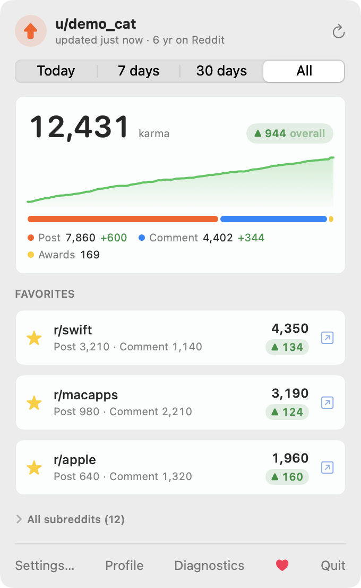
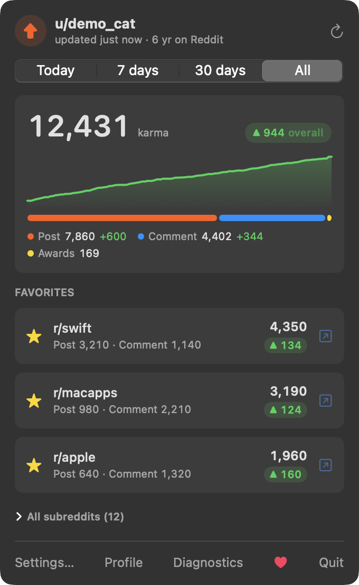
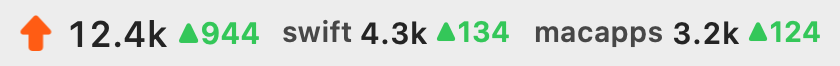

# Krma

Your Reddit karma in the macOS menu bar, with the "local karma" of the subreddits you star.

<p align="center">
   
</p>
<p align="center">
   &nbsp; 
</p>

- **Menu bar**: total karma (`12.4k`), how much it moved today / this week / this month (▲ green, ▼ red), and up to three favorite subreddits with their own karma and change.
- **Popover**: exact total with a sparkline, the post / comment / award split, one row per favorite subreddit, and a filterable list of every subreddit you have karma in (plus your subscriptions) to star more.
- **Local karma** is the per-subreddit figure Reddit itself keeps (what moderators see), read straight from the API, so it's exact and includes activity older than Reddit's 1,000-item listings.
- **History** is kept on your Mac, so "today", "7 days" and "30 days" are real deltas, not guesses.
- **Notifications** for milestones (1k, 5k, 10k… and favorites' 100, 500, 1k…) and for jumps of 25+ karma between refreshes, naming the subreddits behind them.
- **Updates**: a daily anonymous check of this repo's latest GitHub release, an **Update** button in the popover, and an Ed25519-signed archive that must match the key built into the app (turn it off in Settings → General).
- No telemetry. Besides reddit.com, the only request is the update check to api.github.com, which sends no token or identifier.

Sibling of [Quotacat](https://github.com/mrte1122/Quotacat) (GitHub quotas in the menu bar) and built the same way.

## Install

Requires macOS 14 or later. Build from source:

```bash
./scripts/build-app.sh --install
```

That builds a universal app into `build/Krma.app`, copies it to `~/Applications`, and signs it with your Developer ID certificate if one is in the Keychain (ad-hoc otherwise).

## Sign in

Krma uses Reddit's OAuth sign-in for *installed apps*: it opens reddit.com in your browser, you approve, and Reddit sends you back to the app through the `krma://` link. Krma only asks for the `identity` and `mysubreddits` scopes; it cannot post, vote or read messages. Tokens live in the macOS Keychain.

Reddit requires every client to be registered, and since late 2025 its [Responsible Builder Policy](https://support.reddithelp.com/hc/en-us/articles/42728983564564-Responsible-Builder-Policy) also requires **approval before an account can create an app**: on an unapproved account the *create app* button at reddit.com/prefs/apps does nothing. Until Krma ships with a built-in client ID, the sign-in card asks for one. To get one:

1. Check [reddit.com/prefs/apps](https://www.reddit.com/prefs/apps) for any app you created in the past. Older credentials still work: edit it, add `krma://oauth` as its redirect URI, and use its client ID.
2. Otherwise file Reddit's developer access request. [docs/reddit-api-access-request.md](docs/reddit-api-access-request.md) has the form link and ready-to-paste answers.
3. Once approved, create an **installed app** with redirect URI exactly `krma://oauth`, copy the short ID under its name, and paste it into the sign-in card or Settings → Account.

To stop Krma's access, use Sign Out (which revokes the token) or Reddit → Settings → Privacy → *Third-party app authorizations*.

## Settings

| Tab | What's there |
|---|---|
| General | refresh interval (1–30 min, default 5), notifications and the jump threshold, launch at login, version and Check for Updates, diagnostics |
| Subreddits | favorites: drag to reorder, add by name, remove; how many go in the menu bar |
| Appearance | light/dark/system; which parts the menu bar shows (glyph, total, change, favorites, exact numbers, monochrome) with a live preview; the change period |
| Account | who's signed in, API usage this window, history size, sign out, client ID |

## Shell integration

Every refresh writes `~/Library/Application Support/Krma/karma.json`:

```json
{
  "user": "demo_cat",
  "total": 12431, "post": 7860, "comment": 4402, "awardee": 120, "awarder": 49,
  "period": "today", "change": 37, "changeSince": "2026-10-24T05:00:00Z",
  "favorites": [{ "name": "swift", "post": 3210, "comment": 1140, "total": 4350, "change": 12 }],
  "updatedAt": "2026-10-24T15:02:11Z"
}
```

History lives next to it in `history.json`.

## Command line

```bash
build/Krma.app/Contents/MacOS/Krma --selftest           # pure-logic checks, no network
build/Krma.app/Contents/MacOS/Krma --once               # one refresh, print diagnostics
build/Krma.app/Contents/MacOS/Krma --sign-in            # the OAuth flow from the terminal (paste the redirect URL)
build/Krma.app/Contents/MacOS/Krma --demo               # run with sample data
build/Krma.app/Contents/MacOS/Krma --snapshot docs --demo   # render the popover and menu-bar PNGs
build/Krma.app/Contents/MacOS/Krma --launch-at-login on
build/Krma.app/Contents/MacOS/Krma --check-update       # print the latest release version
build/Krma.app/Contents/MacOS/Krma --update             # download, verify, and install the latest release
```

## Releasing (maintainers)

One-time setup: a "Developer ID Application" certificate in your Keychain, notarization credentials stored with `xcrun notarytool store-credentials krma-notary` (or reuse Quotacat's: `KRMA_NOTARY_PROFILE=quotacat-notary`), and an update-signing key from `swift scripts/sign-update.swift keygen` (kept in `~/.config/krma`, never in the repo; back it up).

```bash
./scripts/release.sh X.Y.Z "Describe what changed"
```

`release.sh` bumps `VERSION`, builds the universal app, signs it with your Developer ID, has Apple notarize it, signs `Krma.zip` for the updater, tags, pushes, creates the GitHub release, and bumps `Casks/krma.rb` in [mrte1122/homebrew-tap](https://github.com/mrte1122/homebrew-tap) if that cask exists.

## How it works

See [DESIGN.md](DESIGN.md): data sources, the sign-in flow, how history and deltas are computed, and the file layout.

## License

MIT. If Krma brightens your menu bar, tips are welcome at [ko-fi.com/mrte90](https://ko-fi.com/mrte90).
